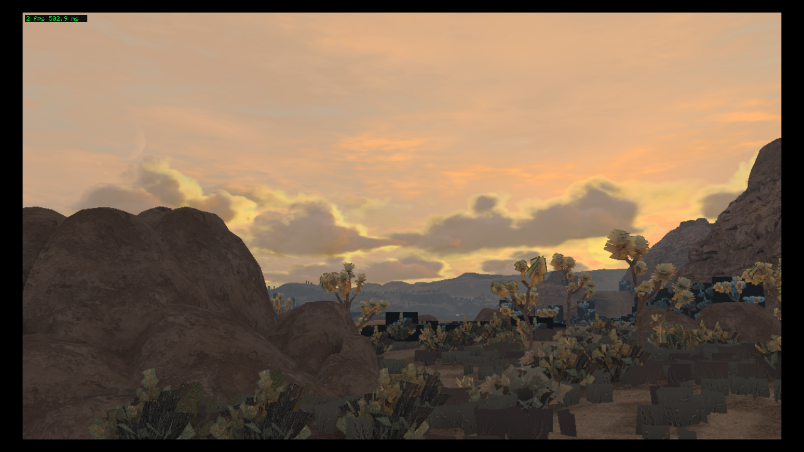

# RDR -- pause point, 2026-11-13

Everything below is measured and committed. Nothing is in flight: no game, no
compilation, no subagent. The machine lock is free.

## The state reached

**RDR's opening scene is drawn.** The title renders the full Red Dead Redemption
landscape -- desert, Joshua trees, rocks, sunset sky -- into a local colour
surface at guest offset `0xe20000` (1152x640). That surface is complete and
correct; the renderer is doing its job.

What the user sees instead is a **solid green screen** at 1-2 fps, because the
composition step reads the wrong memory. The mechanism is one line,
`runtime/src/gpu/rsx_renderer.cpp:2111`:

    if (s->offset != t.offset || s->width < w || s->height < h) continue;

The title samples the scene as a **2304x640** texture -- exactly 2 x 1152, two
surfaces side by side. The `Surface` at that offset is 1152 wide, so
`s->width < w` rejects it, all three fast-path matches stay null, and the bind
falls through to `memory_texture()`, which decodes **guest memory**. Guest memory
is never written for that surface: `schedule_writebacks()` runs every frame but
only writes surfaces with `main == true`, and `main` requires DMA context
`LOCAL+1`. The title created exactly two main surfaces (1x1 and 128x128); the
scene is not one of them.

That is RPCS3's "Write Color Buffers" being **off for exactly the surfaces this
game samples**.

## The proof

Presenting the scene surface directly puts the game on screen:

    GOWA_SHOW_SURFACE=0xe20000 ./build-rdr/ps3base --no-launcher

`docs/findings/green/scene-presented-GOWA_SHOW_SURFACE.png`, 727 617 bytes,
sha256 `d8c0f2cb670c1d2e5184eb8b41052d714d4e8549c391d9795505f3ecb0ee1691`.
`is_green` on it is **0.0000** -- it is not green.

The same surface dumped from the renderer, without the presentation override:
`docs/findings/green/scene-0xe20000.png`
(sha256 `1fbbba26aed3a55cdece19a5925e0fc6b254b283f804af6065702f70021b23d1`),
mean 0.4976, standard deviation 0.2221.

For contrast, the surface the swapchain actually presents,
`docs/findings/green/green-screen.png`
(sha256 `72d03fe9d29d01e5d64ab98d1a5feb0b11ed6285ef43a0e0df42a5ed5a9342f6`):
srgb(0,145,0), 88.95 % of the frame, **standard deviation exactly 0** -- a flat
fill, not a scene that faded.

## Commits

This session, oldest first. All on `main`.

| commit | what |
|---|---|
| `144446974a05ea9ddf016dae2281f5980c72a741` | perf: the green screen is slow because the SPU threads interpret, not because of fibres |
| `a08d0ce4ba8e75e22e337b68b9270f5040a12115` | cellFiber: reuse host stacks, stable thread state, and a switch without a syscall |
| `d77d3a32c50b63008cee9ef88cc35573bd2c863c` | crash: print the host stack and the last indirect calls when rip is 0 |
| `3867787302764ff70d95c577d2785cb7593394e2` | docs: the fibre cost, measured -- 261.3 KB per fibre to 18.2 KB |
| `0e2f514734fba226f429003f7ca7de71816248e6` | green: the scene IS drawn -- it is lost at composition, and here is the mechanism |
| `95aaeb6d07e77b6c025036edd9ae96ee02bc65be` | harness: bound the sampling loops by time, not by sample count |

Earlier in the same day, the commits this work stands on:

| commit | what |
|---|---|
| `7a395ba` | rdr: the 17-entry dispatch table resolves, and the title reaches its chapter card |
| `b6ed791` | lock: one machine-wide lock, and a forced stop that leaves nothing |
| `48f2a20` | lift: name the seeds a lift used, and relift when an input is newer |
| `6bc1c43` | rdr: the loading-screen crash stopped reproducing, and the fault address was never a guest address |
| `58ab03c` | regress: RDR's criterion is the screen AFTER the loading, not the loading card |
| `5887a70` | rdr: s2 report -- the loading screen does not crash, it fades to green at 1-2 fps |

Evidence documents: `docs/findings/f-rdr-loading-screen.md`,
`f-rdr-cellfiber-table.md`, `f-rdr-fibre-cost.md`, `f-rdr-dispatch-table.md`,
`RESULTS-PERF.md`, `RESULTS-GREEN.md`, `RESULTS-S3.md`.

## The exact command to get back to this point

Prerequisites (all present on this machine):

    disc      /root/Dev/rdr-port/vfs/dev_bdvd      (BLES00680)
    dev_flash /root/Dev/devflash-out/dev_flash     (GOWA_FLASH_DIR is MANDATORY:
                                                    without it RDR has no audio
                                                    codec and dies at 23 s)
    lift      /root/Dev/ps3base2/out-rdr/ppu
    SPU lift  /root/Dev/ps3base2/out-rdr/spu
    binary    /root/Dev/ps3base2/build-rdr/ps3base

Rebuild if the binary is absent:

    cd /root/Dev/ps3base2
    ulimit -s unlimited                       # rdr_049.cpp kills clang otherwise
    cmake -S . -B build-rdr -G Ninja \
      -DCMAKE_BUILD_TYPE=RelWithDebInfo \
      -DCMAKE_C_COMPILER=clang -DCMAKE_CXX_COMPILER=clang++ \
      -DCMAKE_C_COMPILER_LAUNCHER=ccache -DCMAKE_CXX_COMPILER_LAUNCHER=ccache \
      -DPS3BASE_GENERATED_DIR=/root/Dev/ps3base2/out-rdr/ppu \
      -DGOWA_SPU_GENERATED_DIR=/root/Dev/ps3base2/out-rdr/spu \
      -DPS3BASE_SPU_NATIVE_GEN_DIR=/root/Dev/ps3base2/out-rdr/gen/spu
    ./tools/build_slot.sh cmake --build build-rdr -j 8 --target ps3base

Run to the green screen, one instance under the machine lock:

    cd /root/Dev/ps3base2
    tools/machine_lock.sh status                      # must say "free"
    pgrep -f -- 'build-rdr/ps3base --no-launcher'     # must print nothing
    tools/machine_lock.sh run 'rdr to the green' -- \
        tools/green_screen_probe.sh /tmp/rdr-green 900

`green_screen_probe.sh` starts its own Xvfb, runs the title through
`tools/drive_rdr.py` (which presses START and walks title -> menu -> ALERT ->
WARNING -> LOADING -> chapter card), samples one frame per second, stops when
`tools/is_green.py` says the frame is green (~167 s to the card, ~90 s more to
the green), then SIGKILLs the driver so the guest survives for inspection.

To see the scene instead of the green, add the override to the guest's
environment:

    GOWA_SHOW_SURFACE=0xe20000

and the opening landscape appears.

To dump the surfaces for a frame:

    PS3BASE_DUMP_FRAMES=20      # schedule_dumps(): every colour surface
    GOWA_SNAP_EVERY=10          # schedule_snapshot(): the presented image
    PS3BASE_TEXIMG=1            # texture snapshots
    GOWA_EVTRACE=tex            # per-bind trace (kind, offset, rect)

## Next actions, in order

### (a) Honour a texture request wider than the surface -- `rsx_renderer.cpp:2111`

The title asks for 2304x640 at offset `0xe20000`; the surface there is 1152x640.
2304 = 2 x 1152 exactly: it is sampling **two adjacent surfaces as one texture**.
The fix is either to create the surfaces at the width the title samples, or to
stitch the adjacent surfaces into the temp image when `w` is a small multiple of
`s->width`. This is the smallest change that makes the composition read the
picture that already exists.

### (b) Write non-main surfaces back into guest memory

`schedule_writebacks()` (`:3926`, called per present at `:4445`, completed by
`complete_writebacks()` at `:3950`) writes only `dirty` surfaces, and `dirty` is
set at `:1309` and `:2825` behind `s->main`. The scene surface is not main, so
it is never written back and the guest-memory path in (a) reads stale data. This
is RPCS3's "Write Color Buffers", and this title needs it on. The machinery
exists and runs; the gate is the `main` condition.

### (c) The cost of `spu::aot::note_interpreted` -- 30 % of the time

The 30 s profile (`RESULTS-PERF.md`) puts `spu::aot::note_interpreted` at 12.41 %
self / **30.01 % inclusive**, with `is_terminator` 5.77 % and `aot::find` 1.74 %.
The bookkeeping (19.92 %) costs more than twice the instruction emulation it
supports (9.07 %). 19 584 blocks were compiled, so this is a working compiled set
that does not cover the blocks the title runs on this screen. The convergence
loop has to be re-run **on this scene**: the blocks that miss are the ones this
screen executes, and that set is what the loop must be fed.

### (d) The rare crash: `rip = 0`

A NULL HOST CODE POINTER, not a guest address -- the reported
`guest 0xffff8bd390000000` is `0 - vm::g_base` exactly. The crash handler now
prints the host stack (`stack_from` no longer discards it when `rip == 0`) and
the last 16 indirect calls (lr, target, ctr, r3) from a ring in
`ppu::call_indirect`. The next occurrence will name the call; that is what the
last one could not do.

## Two known defects, recorded and not fixed

- `GOWA_DRAW_LOG` / `GOWA_TRACE_AT` crash through an out-of-bounds read at
  `rsx_renderer.cpp:3356`: the guard checks 64 bytes at `tea` and then
  dereferences `tea+0x1c2a00`; the fault is at guest `0xcfa9b600` while video
  memory ends at `0xcf900000`.
- `CreateFiber`'s host stack is now pooled (261.3 KB per fibre -> 18.2 KB,
  measured), but `ThreadState`'s `fibers` vector still grows to the high-water
  mark of fibres ever created and never shrinks.

## Remote state at the pause

`origin/main` had been rewritten ahead of this branch by the V/H track (89
commits, tip `18754f8`). Those commits are preserved on `origin/explore/hV`, and
this branch's `main` was pushed over `origin/main` with
`--force-with-lease` after that branch was verified on the remote. The four
worktree branches (`explore/tT1`, `explore/tT2`, `explore/tV`,
`explore/wasm-base`) are pushed, so no work depends on a worktree. The older
`agent-*` and `explore/*` branches are **not** pushed: they carry derived blobs
the remote's pre-receive hook rejects (`memdump.bin` 426 MB, `vfs/dev_hdd1/cache.dat`
1790 MB, RDR save data 514 MB). They are local history, not work in flight; a
filter would be needed to push them, and that is a separate decision.
